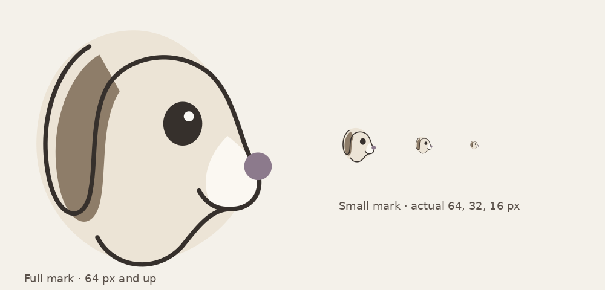

# FeedBaxter v1 Spec

Last updated Nov 1, 2026 · Owner: Nick · Amended per `docs/REVIEW.md` (architecture review)

## Overview

FeedBaxter captures one-way text feedback from web, iOS and macOS apps through an API, and gives teams a simple inbox to triage it. It runs as a free, open-source, single-tenant self-hosted app or as a paid multi-tenant SaaS.

**Principles**

- **Set up in minutes.** Sign up, copy the Default channel's key, make one API call.
- **One-way only.** No replies to end users, no conversations.
- **Tiny footprint.** One Go binary that runs on the smallest VM; self-host is a single Docker service.
- **Simple first.** Features appear only when needed (channels stay hidden until there are two).
- **AI from outside.** No AI runs inside FeedBaxter; triage happens through the MCP server with the customer's own AI client.

**Baxter.** The name is the joke: Feedback-ster = Feed Baxter. Baxter is a dog drawn as layered cut paper under a single ink line, and the feedback is his food. He stays cute without being cutesy: the illustrations carry the charm, while UI copy stays plain and factual.

## Architecture

FeedBaxter is one Go binary with modes. Self-host runs everything in a single Docker service; SaaS runs the same binary as separate deployments against Postgres and a standalone NATS server.

```
App SDK ──► Ingest API ──► Queue ──────────► Processors ×N ──► Database
            key cache      NATS JetStream    batch inserts     SQLite / Postgres
            quota          capped, no drops                          ▲
            counters                                                 │ reads, writes
               ▲                                                     │
               │  NATS KV `keys` bucket (ingest watches it)          │
               └──────────────────────────────────────────────── BFF ┘
                                                                 ▲
                                                  Admin UI ──────┤
                                                  MCP server ────┘
```

Feedback flows left to right and is written only by processors. The BFF writes every key and limit change into a NATS KV bucket that ingest watches, so changes take effect instantly and nothing is lost. Ingest never calls the BFF.

| Mode | Does | Self-host | SaaS |
| --- | --- | --- | --- |
| `ingest` | Validates keys, enforces caps, enqueues | In-process | Own deployment |
| `worker` | Drains the queue into the database | In-process | Own deployment, N replicas |
| `api` | BFF, admin UI, MCP server | In-process | Own deployment |
| `all` | Every mode plus embedded NATS | Default | Not used |

**Footprint targets (measured, see `docs/REVIEW.md`):** a static binary in a scratch image of at most 32 MB, idling at no more than 48 MB of RAM, both checked in CI. The React admin UI is compiled in with `go:embed`.

**Tenancy:** the core talks to a `TenantResolver` interface. Self-host's resolver always returns the single tenant; the multi-tenant resolver lives in the private SaaS layer, which imports the public module (see Open source and licensing).

**Architecture detail:** `docs/ARCHITECTURE.md` is the engineering source of truth for packages, interfaces, subjects, buckets and config; this spec is the product source of truth.

## Ingest and quota pipeline

Feedback never goes straight into the main database. Ingest validates, counts and enqueues; processors write to the database at a steady, batched rate. All caps are enforced at ingest, so a tenant is rejected on the very next request after hitting a limit.

**Ingest API (stateless, thin)**

1. Hash the presented key and look it up in the in-memory **key cache** (hash → key ID, channel, tenant, daily and monthly limits, revoked). Unknown or revoked → `401 invalid_key`. There is no fallback lookup; ingest never talks to the BFF.
2. Enforce payload size and a short-window per-key rate limit.
3. Increment the tenant's **daily** and **monthly** counters in memory. Over a limit → reject immediately.
4. Publish the raw request body to the queue with the envelope fields as message headers: tenant, channel, key ID, received time, idempotency key. No client IP is collected or stored anywhere. If the request carries no `idempotencyKey`, ingest generates one.
5. Return `202 Accepted`. No database access on this path.

The endpoint is called cross-origin from browsers with a publishable key, so ingest answers CORS preflight (`OPTIONS`) from memory with a long `Access-Control-Max-Age`.

**Key cache**

- One NATS KV bucket, `keys`, is the ingest-facing source of truth: `sha256(key) → {key ID, channel, tenant, daily limit, monthly limit, revoked}`. The BFF writes an entry on every key create, revoke, plan change and limit change.
- Ingest watches the bucket. The replay on startup fills the cache and gates readiness; live updates arrive as they happen. KV is JetStream-backed, so no event is lost.
- A periodic database → KV reconcile in the BFF is a safety net only: `KEY_CACHE_RESYNC_INTERVAL` (default `5m`).

**Quota counters**

- Counters live in memory in ingest and flush to a NATS KV bucket every `COUNTER_FLUSH_INTERVAL` (default `5s`); they reload from KV on startup.
- Daily window is fixed and resets at midnight UTC. Monthly window resets at the start of each billing month.
- Each flush reads the shared KV value, adds the replica's local delta and writes it back with compare-and-swap, retrying on conflict. With several ingest replicas, overshoot is therefore at most one flush interval of traffic per replica. The per-key rate limit is per replica too, so N replicas allow N times the configured rate.
- All channels in a tenant share the same counters. Deleting feedback does not refund quota.
- The daily limit is protection against runaway loops and abuse; the monthly limit is the plan limit.
- Limits are plain numbers on the key-cache entry. Enforcement is core and identical in both editions; deciding the numbers (plans, billing) is the SaaS layer's job. Self-host defaults to unlimited and may set an optional `DAILY_LIMIT` in config.

**Rejection responses**

| Condition | Status | Error code | SDK behaviour |
| --- | --- | --- | --- |
| Bad or revoked key | 401 | `invalid_key` | Don't retry |
| Payload too large | 413 | `payload_too_large` | Don't retry |
| Rate limit | 429 | `rate_limited` | Retry after `Retry-After` |
| Daily cap | 429 | `daily_limit` | Retry after `Retry-After` (next UTC midnight) |
| Monthly plan cap | 429 | `plan_limit` | Stop retrying; optional small local backlog |
| Queue full | 503 | `queue_full` | Retry with backoff |

**Queue: NATS JetStream**

- One stream, one subject (`feedback.ingest`), global cap via `MaxMsgs` and `MaxBytes` with `DiscardNew`, so a full queue rejects new messages rather than dropping old ones. Ingest publishes synchronously and maps the stream's rejection to `503 queue_full`.
- The cap is global, not per tenant: the daily cap and rate limit are the fuse against one tenant filling it. A per-tenant in-flight cap is a later item.
- Embedded in-process for self-host; standalone for SaaS.

**Processors**

- Stateless workers, scaled by replica count (no autoscaling).
- Pull a batch, validate and normalize, batch-insert into the database, then ack.
- At-least-once delivery; a unique constraint on `(tenant_id, idempotency_key)` makes redelivery harmless.
- JetStream does not dead-letter by itself. On the final allowed delivery the processor publishes the message to a small `feedback.dlq` stream and acks it; unparseable payloads go there on first sight.
- Processors know nothing about quotas or billing.

**Operational metrics:** queue depth, oldest-message age and dead-letter count, shown on an internal ops page. Rising oldest-message age means add a processor replica.

## Data model

Every table carries `tenant_id` in both editions, so the schema and migrations are identical; self-host simply has one tenant row. All tables live in one schema with plain names.

| Entity | Key fields | Notes |
| --- | --- | --- |
| Tenant (org) | id, name, plan\_id, billing\_month\_start, created\_at | Self-host: exactly one, created at first boot |
| User | id, tenant\_id, email, password\_hash, role, must\_change\_password | Role is `admin` or `reviewer` |
| Personal access token | id, user\_id, hash, name, last\_used\_at | Used by the MCP server; carries the user's role |
| Channel | id, tenant\_id, name, created\_at | A `Default` channel is created with every tenant |
| Ingest key | id, channel\_id, prefix, hash, revoked\_at | Publishable; can only create feedback |
| Feedback | id, tenant\_id, channel\_id, message, user\_id, metadata (JSON), app\_version, platform, status, idempotency\_key, received\_at, updated\_at, updated\_by | Unique on (tenant\_id, idempotency\_key). No client IP column, by design |
| Tag | id, tenant\_id, name | Created freely by people or MCP |
| Feedback tag | feedback\_id, tag\_id | Many-to-many |
| Status change | feedback\_id, from, to, user\_id, via (`ui` or `mcp`), at | Lightweight history |
| Plan (SaaS only) | id, name, monthly\_limit, daily\_limit, price, stripe\_price\_id | Edited from the super-admin page |

**Statuses:** `new`, `reviewed`, `actioned`, `ignored`.

**Indexes:** `(tenant_id, status, received_at)` for the inbox, `(tenant_id, channel_id, received_at)` for channel views, `(tenant_id, user_id)` for per-user views and deletion.

**Databases:** SQLite for self-host, Postgres for SaaS. Partition feedback by month in Postgres if it ever gets large.

## Accounts, roles and auth

There are two roles. Seats are unlimited on every plan.

| Capability | Admin | Reviewer |
| --- | --- | --- |
| View all feedback, all channels | Yes | Yes |
| Set status (reviewed, actioned, ignored) | Yes | Yes |
| Add and remove tags | Yes | Yes |
| Export CSV / JSON | Yes | Yes |
| Use the MCP server (own token) | Yes | Yes |
| Delete feedback | Yes | No |
| Manage channels and ingest keys | Yes | No |
| Invite and remove people | Yes | No |
| Billing and plan | Yes | No |
| Delete the org | Yes | No |

An org can have several admins, but the last admin can't be removed or demoted.

**SaaS auth:** email and password, email invites, password reset by email. This lives in the private SaaS layer.

**Self-host auth (no email server needed):**

- First boot prints a one-time admin password to the container logs; first login forces a password change.
- Admins add people by email and get a temporary password to share; the new user changes it on first login.
- Forgotten password → an admin resets it to a new temporary one.
- Locked-out admin → `feedbaxter reset-admin` CLI inside the container.

**Personal access tokens:** each user creates their own in their profile for the MCP server. Tokens inherit the user's role and are revoked when the user is removed.

## Admin UI and design direction

The admin UI is the only visual surface; the SDKs are API-only, so customer apps never show FeedBaxter branding.

**Screens (v1)**

- **Onboarding:** shows the Default channel's ingest key and a copy-paste first API call.
- **Inbox:** list of feedback with status filter, tag filter, search, and bulk status changes. Opens on "All channels" once a second channel exists.
- **Feedback detail:** message, user ID, platform, app version, metadata, tags, status history.
- **Per-user view:** all feedback for a `userId`, plus "delete all feedback for this user".
- **Channels and keys (admin):** create channels, create and revoke ingest keys.
- **People (admin):** invite, remove, change role.
- **Billing (admin, SaaS):** plan, usage this month, upgrade.
- **Profile:** password, personal access tokens.
- **Super-admin (SaaS, Nick only):** plans, price migration, ops metrics.

**Progressive disclosure:** with one channel, there is no channel switcher, channel column or per-channel stats. Adding a second channel reveals them.

Visual design follows the Styleguide section below.

## Styleguide

FeedBaxter should feel like a boutique stationery shop: elegant, grown-up, good paper. Not a kindergarten, and not a Japanese print. Charm comes from Baxter and the paper; everything functional stays quiet and crisp.

### Baxter



- **Construction:** layered cut-paper shapes (a rounded cream head, an offset bark-brown ear, a lighter cream snout piece) under one continuous ink line. Head only, three-quarter view facing right.
- **Character:** cute to adults, not kids. One big dark eye with a single catchlight, never a double anime sparkle. Round dusk nose.
- **Full mark:** 64 px and up.
- **Small mark:** below 64 px (favicon, app icon). Same drawing with a heavier line (3.2 vs 2.2), a slightly larger eye and nose, and no eye highlight.
- **App icon:** the small mark on a solid paper tile; dusk tile as a bolder alternative.
- **Accessibility:** `aria-hidden` beside the wordmark; `role="img"` with the label "FeedBaxter" when standing alone.
- **Source files:** `assets/brand/baxter-full.svg` (full mark) and `assets/brand/baxter-small.svg` (small mark). Final production artwork can be refined by an illustrator from this mark.

### Palette: oat and dusk

Muted, unbleached craft-paper tones with one dusky purple accent. Light mode only in v1. Text is dark brown ink, never black.

| Name | Hex | Role |
| --- | --- | --- |
| Paper | `#F4F1EA` | Page background |
| Card stock | `#FAF8F4` | Raised surfaces, panels |
| Oat | `#ECE4D6` | Sunken areas, tags, Baxter's head |
| Hairline | `#DDD6CA` | Row dividers |
| Kraft | `#C2B39C` | Borders, stronger rules |
| Bark | `#6F6151` | Small details |
| Ink | `#36302C` | Body text, Baxter's line |
| Ink soft | `#5A514A` | Secondary text |
| Ink muted | `#73695F` | Metadata |
| Dusk | `#8C7A8C` | Baxter's nose and the "new" dot |
| Dusk deep | `#66586A` | Primary button, links |
| Dusk tint | `#E9E3E8` | Selected rows, New chip |
| Dusk ink | `#4E4352` | Text on dusk tint |
| Sage tint / Sage ink | `#E2E8DC` / `#46573D` | Actioned chip |
| Brick | `#9E5A4C` | Destructive actions only |

**Rules**

- Dusk is the only accent. One primary (dusk deep) button per screen.
- Baxter's nose and the "new" status dot are the same colour and shape: a small dusk circle always means "new".
- Brick appears only on destructive actions (delete feedback, delete org), never decoratively.
- Paper texture: a very subtle fine grain on the page background only. No torn or deckled edges, no watercolour effects, no drop shadows on cards.

### Typography

**Fraunces** (serif) for the wordmark and page titles only; **Inter** (sans) for everything else. Both are open-licensed Google Fonts, bundled into the binary so self-hosters make no external font calls.

| Use | Font | Size / weight | Colour |
| --- | --- | --- | --- |
| Wordmark | Fraunces | 24 px, 400 | Ink |
| Page title | Fraunces | 26–28 px, 400 | Ink |
| Feedback message | Inter | 16.5 px, 400, line height 1.65 | Ink |
| UI text, buttons | Inter | 13–14 px, 400 / 500 | Ink, ink soft |
| Metadata, labels | Inter | 12–12.5 px, 400 | Ink muted |

**Feedback readability (non-negotiable)**

- The customer's message is always the most prominent thing on the screen: larger than metadata, in ink, on plain paper.
- Line length capped at about 62 characters.
- Customer line breaks and numbered steps are preserved exactly as typed (`white-space: pre-line`); no Markdown rendering of user input.
- Metadata sits on one quiet line above the message: status, user ID, platform, version, time.

### Statuses and components

Every status has a distinct shape and a visible word, so none depends on colour alone.

| Status | Marker | Chip |
| --- | --- | --- |
| New | Solid dusk circle (Baxter's nose) | Dusk tint, dusk ink text |
| Reviewed | Eye icon | Oat, ink soft text |
| Actioned | Check-circle icon | Sage tint, sage ink text |
| Ignored | Minus-circle icon | No fill, dashed stone border, ink muted text |

**Components**

- **Inbox rows:** hairline dividers, no card boxes, no shadows. Status marker, message preview, one metadata line, relative time on the right.
- **Primary button:** dusk deep fill, paper text, 4 px corners. One per screen.
- **Secondary actions:** quiet ink-soft text with a kraft underline (for example "Ignore").
- **Destructive actions:** brick text; confirm dialogs for deletes.
- **Tags:** small oat pills with ink-soft text.
- **Baxter in the UI:** onboarding, empty states, inbox zero, and the monthly-limit state. He never appears inside dense lists and never speaks.

### Accessibility and voice

**WCAG 2.1 AA is a hard requirement** across the whole product.

- Text contrast at least 4.5:1 (ink, ink soft and ink muted all pass on paper); graphical markers at least 3:1 (the dusk dot is 3.5:1).
- Status never conveyed by colour alone: icon or dot plus a visible label.
- Visible focus rings on every interactive element; full keyboard navigation of the inbox, including bulk actions.
- Touch targets at least 44 px; every control labelled.
- Respect `prefers-reduced-motion` for any Baxter animation.

**Voice**

- Plain, factual, sentence case. For example: "Monthly limit reached · 37 submissions rejected".
- Baxter's charm lives in the illustration, never in the copy. No puns in UI text, no "Baxter says".
- Errors say what happened and what to do next.

## MCP server

The MCP server lets a customer's own AI client read and triage feedback; FeedBaxter runs no AI itself. It authenticates with a personal access token, so every action is limited by and attributed to that user's role.

| Tool | Purpose | Role |
| --- | --- | --- |
| `list_feedback` | Filter by status, channel, tag, user ID, date range; paginated | Both |
| `get_feedback` | Full record including metadata and tags | Both |
| `list_tags` | Existing tags with counts | Both |
| `set_status` | Change status on one or many feedback IDs | Both |
| `add_tags` / `remove_tags` | Tag one or many feedback IDs, creating tags as needed | Both |
| `stats` | Counts by status, channel and tag for a date range | Both |

- Bulk operations take up to a few hundred IDs per call, so "tag these 200 as `billing`" is one call.
- Status changes are recorded with `via: mcp` and the user's name in the history.
- Runs inside the same binary as the BFF and uses the same permission checks.
- Transport: Streamable HTTP at `/mcp`, authenticated with `Authorization: Bearer <personal access token>`. The server is remote, so stdio is not offered.

## Ingest API and SDKs

One endpoint accepts feedback: `POST /v1/feedback` with the ingest key in the `Authorization` header. It returns `202 Accepted` or one of the errors in the pipeline section.

```json
{
  "message": "The export button does nothing on Safari",
  "userId": "usr_8f2a91",
  "idempotencyKey": "3b1e6c0a-…",
  "appVersion": "2.4.1",
  "platform": "web",
  "metadata": { "plan": "pro", "screen": "reports" }
}
```

- `message` is required, plain text, with a maximum length (for example 5,000 characters).
- `userId` is optional and must be the customer's internal, non-identifying ID, never an email, phone number or name. The admin UI shows a warning if values look like email addresses but doesn't block them.
- `idempotencyKey` is optional. The SDKs always send one so retries never create duplicates; a raw API call without one gets a server-generated key, and only the SDK's retries are then deduplicated.
- `metadata` is a small free-form JSON object with a size limit.
- Text only in v1. Screenshots and log files are on the roadmap.

**Keys**

- **Ingest keys** are publishable, scoped to one channel, and can only create feedback.
- **Personal access tokens** are secret, per user, and used for MCP. They never ship in an app.

**SDKs (API-only, no UI)**

- **Web:** npm package plus a script tag. `send({ message, userId, metadata })`. Retries temporary failures a few times and can hold pending items in localStorage.
- **iOS / macOS:** one Swift Package. `FeedBaxter.send(message:userId:metadata:)` with async/await. Pending items are written to disk and retried with backoff, which also covers offline users.
- Both accept an optional key per call, so one app can send to several channels.
- On `plan_limit`, SDKs stop retrying and keep at most a small, size-capped local backlog.

## Plans and billing

Pricing is based only on feedback received per month. Seats and channels are unlimited on every plan, and the free plan allows 50 submissions a month.

- **Plans live in the database**, edited on the super-admin page: name, monthly limit, daily limit, price and Stripe Price ID. The free plan has no Stripe price.
- **One version per plan.** Edits apply to every customer on that plan; Nick notifies customers before changes.
- **Price changes:** Stripe prices can't be edited, so the super-admin page creates a new Stripe price and migrates all subscribers, effective at each customer's next billing date.
- **Limit changes:** increases apply instantly; decreases apply from the next billing month.
- **Instant effect:** any plan or limit change is written to the `keys` KV bucket, which ingest watches. An upgrade unblocks a capped customer immediately.
- **Stripe:** Checkout for upgrades, Customer Portal for card and invoice management, webhooks into the BFF for subscription changes.
- **Self-host** has no billing and no limits beyond the queue cap and rate limits; billing code exists only in the private SaaS layer.

## Privacy, retention and deletion

FeedBaxter avoids holding personal data by design: end users are identified only by the customer's opaque `userId`.

- **Retention:** feedback older than 2 years is deleted by a nightly job. The window is a config value.
- **Export:** CSV and JSON from the inbox, respecting active filters, for both roles.
- **Per-user deletion:** delete all feedback for a `userId`, so customers can honour their own users' removal requests.
- **Feedback deletion:** admin-only; deleted feedback still counts toward the month's limit, and the dialog says so.
- **Org deletion (SaaS):** immediate and permanent after typing the org name to confirm. It cancels the Stripe subscription, revokes all ingest keys instantly, and wipes feedback, channels, users and tokens. Invoices remain in Stripe for tax records.

**Terms of Service (customer obligations)**

- `userId` must be an internal, non-identifying value, not an email, phone number or name.
- Customers are responsible for what their end users submit, since free text can contain personal information.
- The privacy policy describes what FeedBaxter itself does with data (PIPEDA, and GDPR if selling into Europe).
- Have a lawyer review both documents before launch.

## Open source and licensing

Self-hosting is free forever, and the core is licensed under **AGPL**.

- **Public repo (AGPL):** ingest, queue, processors, BFF, admin UI, MCP server, SDKs, single-tenant `TenantResolver`, simple self-host auth, and quota *enforcement*. The module exposes `feedbaxter.Run(ctx, Options)` plus a small exported extension surface (`TenantResolver`, `Authenticator`, `LimitsSource`, extra migrations, extra routes, startup hooks).
- **Private repo (SaaS layer):** multi-tenant `TenantResolver`, sign-up and email flows, Stripe billing, plan management, super-admin. It *imports* the public module and fills `Options`; the public tree never references it. No build tags; never published.
- **Why this holds:** the multi-tenant code isn't in the public repo, and AGPL requires anyone running a modified version as a service to publish their changes. License checks or feature flags would be trivially patched out, so the design doesn't rely on them.
- **Contributor License Agreement:** required for outside contributions (CLA Assistant on GitHub), so contributed code can also be used in the private SaaS build.

## v1 scope and roadmap

v1 is text feedback in, triage out, with billing on SaaS. Everything else waits.

**In v1**

- [x] Ingest API with key cache, quota counters and rejection codes
- [x] JetStream queue (embedded and standalone) and scalable processors
- [x] BFF: orgs, users, roles, channels, ingest keys, personal access tokens
- [x] Admin UI: inbox, statuses, tags, bulk actions, per-user view, export, built to the Styleguide
- [ ] Brand assets: Baxter full and small marks as SVG, favicon, app icon, Fraunces and Inter bundled, Baxter for onboarding, empty inbox and the monthly limit
- [x] MCP server
- [ ] Web SDK and Swift SDK (iOS and macOS)
- [ ] SaaS layer: sign-up, email invites and resets, Stripe, plans, super-admin
- [x] Self-host Docker image with first-boot admin and `reset-admin`
- [ ] Retention job, per-user deletion, org deletion
- [ ] Terms of Service and privacy policy

**Not in v1**

- Screenshots and log file attachments (object storage, references in the queue envelope)
- Internal notes and assignment
- Notifications (email, Slack, daily digest)
- Ready-made feedback UI components in the SDKs
- End-user–selected feedback types (channels cover this for now)
- Server-side AI categorization
- Integration with the roadmapping tool (Now / Next / Later)
